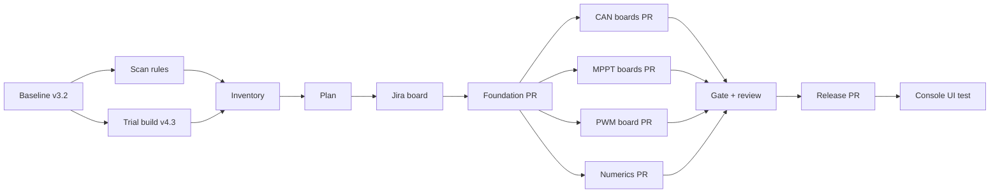

# Charge-controller firmware: Zephyr v3.2 → v4.3 upgrade



Firmware for MPPT and PWM solar charge controllers (C/C++ on
[Zephyr RTOS](https://www.zephyrproject.org/), STM32 F0/L0/G4 targets, CAN and
serial telemetry). This tree targets **Zephyr v3.2**. The supported OS baseline
is moving to **Zephyr v4.3**, and this repository carries everything needed to
do that upgrade with evidence instead of hope.

Standalone rendering of the flow: [docs/flowchart.html](docs/flowchart.html)
([PNG](docs/flowchart.png)).

## What is in here

| Path | What |
|---|---|
| `app/`, `boards/`, `dts/`, `tests/` | The firmware, its six custom boards and 95 unit tests |
| `scripts/ws.sh` | Builds this checkout against a pinned Zephyr workspace (v3.2 or v4.3) |
| `migration/rules/` | Deprecation rule pack for v3.2 → v4.3 with links to the Zephyr migration guides |
| `tools/migrate/` | `scan.py`, `trial.py`, `plan.py`, `gate.py` and their tests |
| `migration/streams.yml` | Work streams, waves and file ownership for the ticket plan |
| `migration/evidence/` | Machine-written evidence: baseline, then one file per ticket |
| `console/` | Migration Console web UI |
| `tests/ui/` | Playwright journeys and the [UI test plan](tests/ui/UI_TEST_PLAN.md) |
| `.agents/skills/` | Skills for the orchestrator, a ticket worker and the UI test |

## The upgrade, step by step

| Step | Command | Output |
|---|---|---|
| Baseline analysis | `make baseline` | `migration/evidence/baseline.json`: 95 tests, flash and SRAM of every board on v3.2 |
| Find deprecated API usage | `make scan` then `make trial` | `migration/inventory.json`: static rule hits plus the diagnostics of building this tree against v4.3 |
| Migration plan | `make plan` | `migration/plan.json`: tickets in three waves with disjoint file ownership |
| Ticket board | orchestrator skill | Jira epic and tasks; keys in `migration/board.json` |
| Parallel tested PRs | ticket skill, one session per ticket | One pull request per ticket against `upgrade/zephyr-4.3` |
| No regressions | `make gate` (also in CI) | Unit tests not removed and passing, tests added for changed code, boards inside flash and SRAM budget |
| Adversarial review | Devin Review on every PR | Findings resolved or answered before a ticket is done |
| See it | `make console` | Migration Console on http://localhost:4173 |

## Quick start

```
pip install west pyyaml pytest
make setup          # Zephyr v3.2 and v4.3 workspaces + ARM toolchain under ~/zephyr-ws (one-off)
make test           # 95 unit tests on the OS version this tree targets
make firmware BOARD=mppt_2420_lc
make scan           # what the upgrade will break
make ui-install && make ui-test
make console
```

Host packages (Ubuntu): `ninja-build gperf device-tree-compiler gcc-multilib g++-multilib rsync`.

## The no-regression gate

`tools/migrate/gate.py` compares the current tree with the recorded baseline:

- every unit test still exists and passes;
- a change under `app/src/` must add unit tests;
- every migrated board builds, stays within **+8 % flash** of its v3.2 size and fits SRAM;
- for the release pull request into the default branch: no board left behind, no new compiler warnings in application code.

CI runs the gate, the tooling tests and the Playwright suite on every push.

## Boards

| Board | MCU | CAN telemetry |
|---|---|---|
| `mppt_2420_hc` | STM32G431 | yes |
| `mppt_2420_rc` | STM32G431 | yes |
| `mppt_2420_lc` | STM32F072 | no |
| `mppt_2420_hpx` | STM32G431 | no |
| `mppt_1210_hus` | STM32L072 | no |
| `pwm_2420_lus` | STM32L072 | no |

## Origin and license

The firmware is the open-source [Libre Solar charge controller firmware](https://github.com/LibreSolar/charge-controller-firmware)
at commit `e175ad0` (its last revision on Zephyr v3.2), licensed under
Apache-2.0 (see [LICENSE](LICENSE)). The migration tooling and console in this
repository are under the same license.
